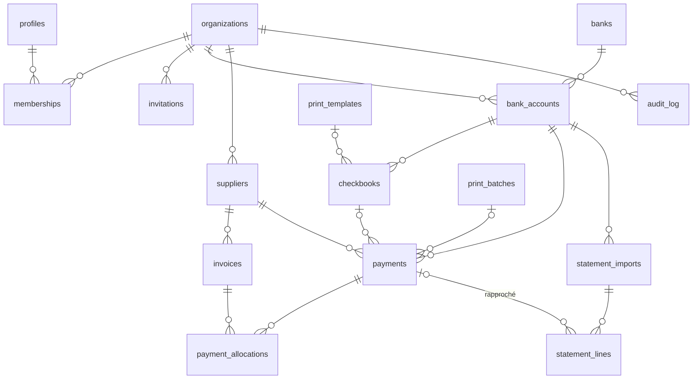

# Architecture

## Arborescence

```
.
├── SPEC.md                      Cahier des charges (référence de chaque phase)
├── supabase/
│   ├── config.toml              Configuration locale (auth, MFA, e-mails)
│   ├── migrations/              Migrations SQL versionnées
│   ├── seed.sql                 Données de démonstration
│   ├── seed-files/              Fichiers d'exemple (relevé CSV)
│   ├── templates/               Modèles d'e-mails d'authentification (français)
│   └── tests/database/          Tests pgTAP (RLS, rôles, isolation)
├── src/
│   ├── proxy.ts                 Rafraîchissement de session, redirections (ex-middleware)
│   ├── app/
│   │   ├── (auth)/              Connexion, inscription, mot de passe, vérification MFA
│   │   ├── (app)/               Espace connecté (barre latérale)
│   │   │   ├── tableau-de-bord/
│   │   │   ├── paiements/       Assistant de paiement, chèques et LCN (Phase 1)
│   │   │   ├── factures/  fournisseurs/  comptes-bancaires/
│   │   │   ├── rapprochement/  rapports/
│   │   │   └── parametres/      Entreprise, membres, sécurité
│   │   ├── (legal)/             Mentions légales, confidentialité (loi 09-08)
│   │   ├── auth/confirm/        Vérification des liens reçus par e-mail
│   │   └── onboarding/          Création d'entreprise, invitations reçues
│   ├── components/
│   │   ├── ui/                  Composants shadcn/ui (Base UI)
│   │   └── app-shell/           Barre latérale, sélecteur d'entreprise, menu utilisateur
│   ├── lib/
│   │   ├── auth/                Couche d'accès (DAL), rôles, erreurs, redirections
│   │   ├── supabase/            Clients navigateur, serveur, proxy, service_role
│   │   ├── organizations/       Actions : création, invitation, changement d'entreprise
│   │   ├── format.ts            Montants « 1 234,56 DH », dates jj/mm/aaaa
│   │   ├── rib.ts               Validation et découpage du RIB marocain
│   │   └── validation.ts        Schémas Zod partagés
│   └── types/                   database.ts généré par la CLI Supabase, app.ts (alias métier)
├── scripts/github-setup.sh      Labels, milestones et issues GitHub
└── .github/                     CI, modèles d'issue et de PR
```

## Principes

- **La RLS est la garantie de sécurité.** Toutes les tables du schéma `public` ont la RLS
  activée (vérifié par un test). L'application lit et écrit avec la session de l'utilisateur ;
  la clé `service_role` ne sert qu'aux traitements serveur (invitations, tâches planifiées).
- **Politiques ensemblistes.** Les politiques utilisent
  `organization_id in (select private.member_org_ids())` : la sous-requête est évaluée une
  fois par requête, pas pour chaque ligne (relevés de plusieurs centaines de lignes).
- **Fonctions d'autorisation `security definer`** dans le schéma `private`, non exposé par
  l'API, pour lire `memberships` sans récursion de RLS.
- **Double authentification au niveau de la base.** Si un utilisateur a un facteur MFA
  vérifié, toute donnée lui est refusée tant que sa session n'est pas de niveau `aal2`.
- **Intégrité multi-tenant.** Les références entre tables métier sont des clés étrangères
  composites `(organization_id, id)` : impossible de lier une facture au fournisseur d'une
  autre organisation, même en connaissant son identifiant.
- **Couche d'accès aux données (DAL)** : `src/lib/auth/dal.ts` centralise la session, le
  contrôle MFA, l'organisation active et les rôles. Chaque page et action protégée y passe.
- **Cache Components (Next.js 16)** : les éléments liés à la session sont rendus derrière
  des `<Suspense>`, le reste de la page est prérendu.

## Rôles

| Rôle | Lecture | Fournisseurs, factures, paiements | Comptes, chéquiers, modèles, relevés | Membres, entreprise |
|---|---|---|---|---|
| Administrateur | ✓ | ✓ | ✓ | ✓ |
| Gestionnaire | ✓ | ✓ | ✓ | — |
| Préparateur | ✓ | ✓ | — | — |
| Comptable | ✓ | — | — | — |
| Expert-comptable externe | ✓ | — | — | — |

Le journal d'audit est lisible par les administrateurs, gestionnaires et comptables.

## Schéma de la base



| Table | Rôle |
|---|---|
| `organizations` | Entreprise (tenant) : raison sociale, ICE, IF, RC, ville d'émission, CA annuel, paramètres |
| `profiles` | Profil utilisateur (nom, fonction du signataire, organisation récente) |
| `memberships` | Appartenance utilisateur ↔ organisation, avec rôle |
| `invitations` | Invitations en attente, acceptées via `accept_invitation()` |
| `banks` | Référentiel des banques marocaines (commun + ajouts par organisation) |
| `bank_accounts` | Comptes bancaires (RIB 24 chiffres, soldes) |
| `checkbooks` | Chéquiers et carnets de LCN : plage de numéros, prochain numéro |
| `print_templates` | Modèles d'impression : dimensions, zones en mm, décalage imprimante |
| `suppliers` | Fournisseurs, nom à imprimer, délai convenu |
| `invoices` | Factures fournisseurs : montant « réglé » (paiements émis) et « encaissé » (débité), date limite légale, statut |
| `payments` | Chèques, LCN, chèques de garantie : numéro, montant, échéance, statut |
| `payment_allocations` | Répartition plusieurs-à-plusieurs paiement ↔ facture, avec montant |
| `print_batches` | Lots d'impression |
| `statement_imports` | Relevés importés (fichier, empreinte anti-doublon, format) |
| `statement_lines` | Lignes de relevé, numéro extrait, paiement rapproché, score |
| `audit_log` | Journal d'audit avant/après, alimenté par triggers et `log_audit_event()` |

Fonctions appelables par l'application : `create_organization`, `accept_invitation`,
`my_pending_invitations`, `log_audit_event`.

Stockage : buckets privés `releves`, `factures`, `cheques-scans`, `lettres`,
`modeles-impression`, `logos`, chemins `<organization_id>/…`.
